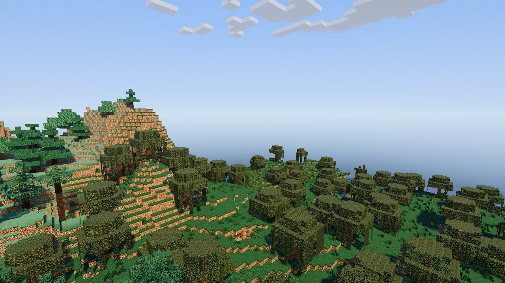
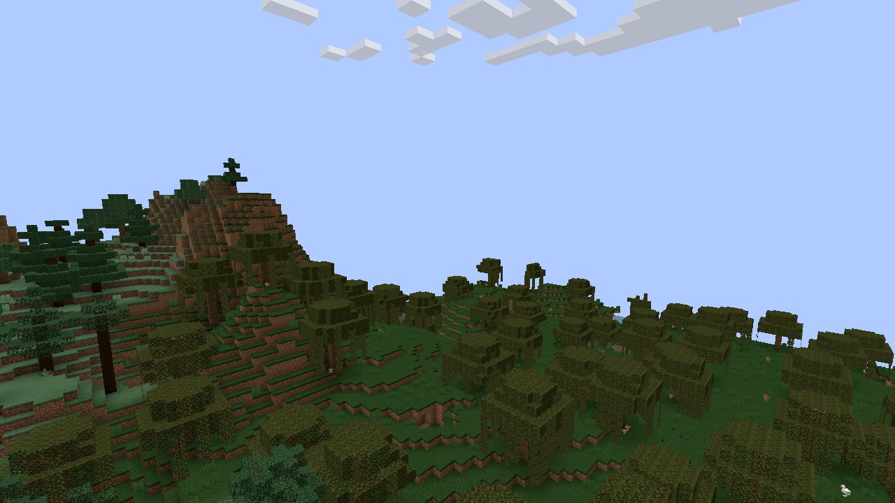
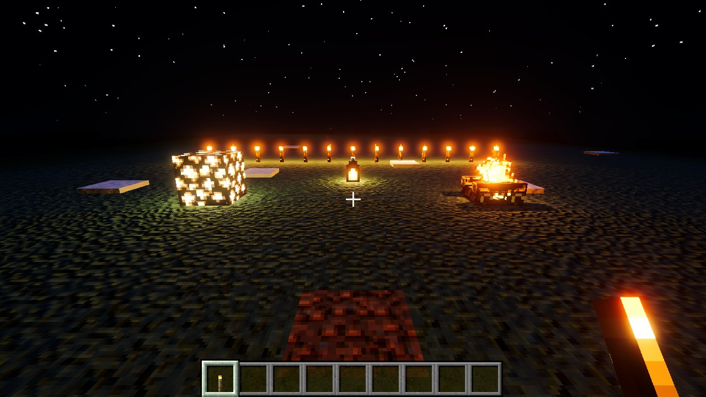
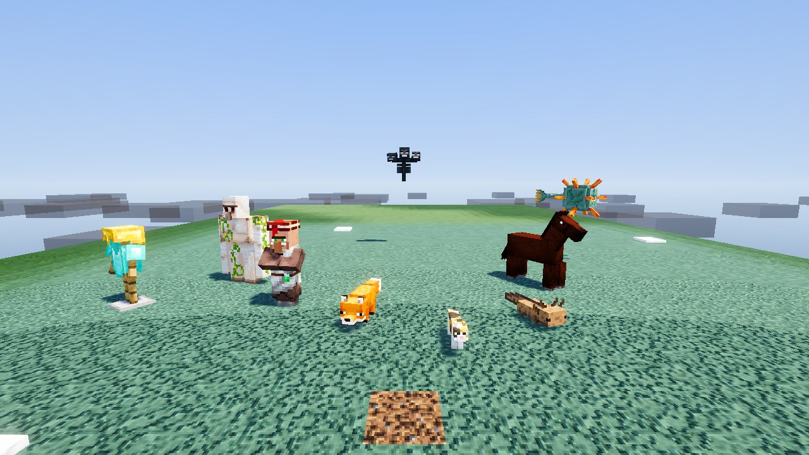
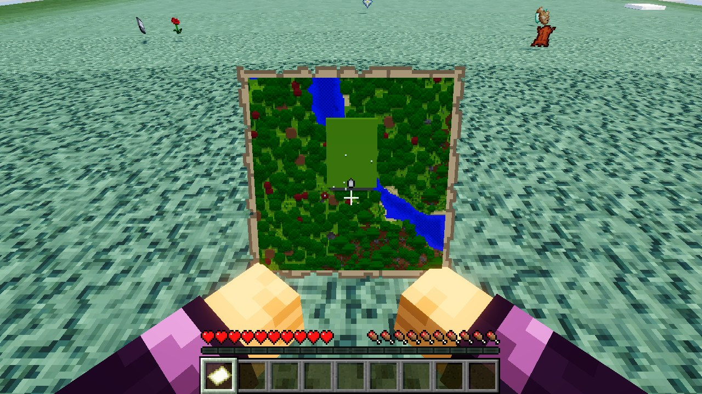
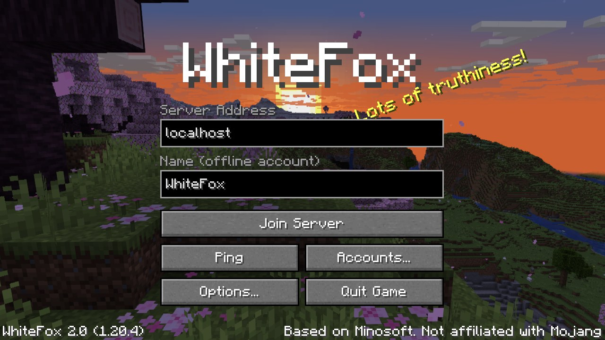
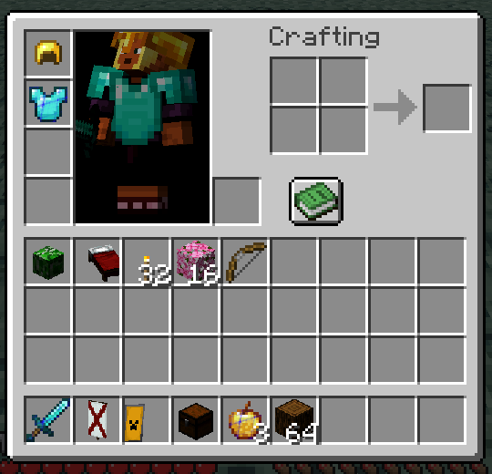

# WhiteFox

A **Unity 6 (URP)** reimplementation of the Minecraft: Java Edition client
**[Minosoft](https://gitlab.bixilon.de/bixilon/minosoft)** (Kotlin, GPLv3). Target version: **1.20.4** (protocol 765).

WhiteFox is a client: it joins servers. There is no singleplayer; the small flat world it can start offline is only a
development test bed.

> Not affiliated with Mojang AB. No Minecraft assets are distributed: the `client.jar` is downloaded from Mojang's
> servers on first start, verified by SHA-1, and only its textures, models, fonts and language files are used. Sounds
> are fetched from Mojang's asset index the first time they play.

## Screenshots

| Realistic mode | Classic mode |
|---|---|
|  |  |
| **Real lights at night** | **Entities** |
|  |  |
| **Map held with both hands** | **Title screen** |
|  |  |

<p align="center"></p>

## Download

Windows builds are on the [Releases](https://github.com/mostazaniikkkk/Whitefox-Client/releases) page. Unzip and run
`WhiteFox.exe`. The first start downloads about 25 MB of game data.

## Features

### Servers and accounts

- Full 1.20.4 connection: handshake → login → configuration → play, zlib compression, server list ping (MOTD,
  players, latency).
- **Optional Microsoft accounts**: sign in with a device code (the client opens microsoft.com/link and copies the
  code), like the official launchers. You stay signed in: the refresh token is kept (it lasts months and is renewed
  every time the client starts) and the 24 hour Minecraft session is renewed silently before joining. A Microsoft
  account joins `online-mode` servers (Mojang session authentication and AES/CFB8 encryption); without one you join
  offline servers with a name, as before. Several accounts can be saved; one is selected.
- Tokens are stored encrypted for the current Windows user (DPAPI) in `accounts.toml`; the file is useless on another
  machine or user account.
- Chat and commands (T or /) with colors, hex colors, bold, underline, strikethrough, obfuscated text, clickable links
  (with confirmation), command suggestions, copy, and hover text; translations from the game's language files.
- Server resource packs (offer, download, SHA-1 check, status replies, removal), with vanilla's prompt or an
  always yes/no setting. Declining a required pack disconnects.

### World rendering

- Block models: blockstates (variants, multipart, weighted), parent inheritance, element and state rotation,
  `uvlock`; all block textures in one `Texture2DArray`, animated textures (`.mcmeta`).
- Section meshing on worker threads: neighbor face culling, per-vertex ambient occlusion, smooth light, biome tint,
  directional shading, opaque/cutout/translucent passes.
- Light engine (sky and block light) with local relighting when blocks change.
- **Cave culling** like Minosoft/vanilla: each section stores which of its faces see each other through non-opaque
  blocks, and a breadth-first walk from the camera section hides everything it can not reach.
- **Floating origin**: the world is drawn relative to an origin near the camera, so it looks the same 20 million
  blocks away as at spawn.
- Biome colors from the server's biome registry and the biomes of each chunk: grass, foliage and water blended across
  borders; per-biome sky, fog and underwater fog. Nether fog, the End's dark sky.
- Particles: the ~100 server particle types with their sprites, block breaking and cracking, the ambient particles
  vanilla spawns on the client (torches, fire, lava, portals, campfires, furnaces, candles…), item crumbs when eating
  and pieces of breaking tools.
- Weather: rain and snow by biome and height, splashes, rain sound, grey sky, lightning flashes. Vanilla fancy clouds.
- Boss bar flags: the wither slowly darkens the sky, the dragon brings thick fog.
- **Dynamic lights** (an OptiFine-style improvement): torches, lanterns, glowstone… held by you, other players or mobs,
  glowing dropped items and burning entities light their surroundings.

### Realistic mode (F6)

On by default; F6 switches to the classic look (Minosoft/vanilla). `-wf-classic` starts in classic mode.

- **Sun and moon** as a directional light with cascaded shadows following the time of day; procedural sky with sun,
  moon and stars; ACES tonemapping, bloom and color grading.
- **Real lights**: every nearby light-emitting block is a point light with physical falloff and its own color; the
  closest ones cast shadows. Minecraft's stepped block light levels are not used in this mode.
- **PBR materials** compatible with **LabPBR** resource packs (`*_n.png`, `*_s.png`): normal maps, AO, smoothness,
  F0/metal and emission. Without a PBR pack, soft normals are generated from the albedo.
- **Water** with animated waves, Fresnel sky reflection, sun glints, refraction and depth-based absorption; emissive
  lava with bloom.
- Quality presets (low/medium/high/ultra) for sun shadows, number of real lights, shadowed lights, relief, water,
  bloom and post-processing.

OptiFine/Iris GLSL shader packs are not supported (Unity does not compile shaders at runtime and its pipeline is
different); their LabPBR resource packs are.

### Player

- Vanilla physics at 20 TPS: walking, sprinting (Ctrl or double W), sneaking without falling off edges, jumping,
  step-up, creative flight, **swimming** (water and lava friction, floating, sinking with Shift, fast swimming,
  currents), **ladders and vines**, cobwebs/berry bushes/powder snow, ice/slime/soul sand/honey, status effects (speed,
  slowness, jump boost, levitation, slow falling, dolphin's grace, blindness) and hunger.
- Survival mining at each tool's real speed, with efficiency, haste/mining fatigue, underwater and airborne penalties,
  and the crack overlay.
- **Elytra** (jump in mid-air to glide, vanilla glide physics, firework boosts), **riptide** tridents (in water or
  rain), pigs and striders steered with their stick, charged horse jumps with the jump bar.
- Drop items (Q, Ctrl+Q for the stack), swap hands (F), use items (eating, bows, shields, potions…).
- First person arm with your skin or the held item, with swing, equip and view bobbing; F5 third person (behind/in
  front, the camera pulls in when it hits blocks).
- HUD: health, food, armor, air, experience, active effects, off hand; underwater/lava fog, night vision, death screen
  with respawn.

### Entities

- Vanilla models with animations (walking, looking, attacking, sneaking, riding, swimming, death, red hurt flash):
  players (vanilla default skin by UUID, or the profile skin on online servers; 64×32 skins converted),
  zombies/husks/drowned, skeletons, creepers, spiders, cows/mooshrooms, pigs, sheep (color and sheared), chickens,
  endermen, villagers/witches/illagers, slimes, wolves, cats/ocelots, iron and snow golems, piglins, llamas, bees,
  fish, squids, bats, foxes, polar bears, blazes, ghasts, horses/donkeys/mules, turtles, dolphins, axolotls, frogs,
  goats, rabbits, parrots, camels, sniffers, the warden, guardians, the wither, the ender dragon, armor stands, boats
  and minecarts. Entities without a model yet are drawn as their hitbox.
- Texture variants: cats, horse colors and markings, llamas, parrots, rabbits, foxes, axolotls, frogs, mooshrooms,
  tropical fish (shape, pattern and colors), villagers and zombie villagers (biome, profession and level).
- The dragon flaps its wings and sways its neck and tail; the wither's ribcage breathes; guardians retract their 12
  spikes while swimming.
- Worn armor (dyed leather included), held items, dropped items with vanilla's per-pixel extruded thickness,
  experience orbs, falling blocks, arrows, thrown projectiles, item frames and all 30 paintings.
- **Enchantment glint** (vanilla texture and scrolling) on enchanted items and books, potions, enchanted golden apples…
  in the inventory, in hand, on the ground and on worn armor.
- Attacking (left click), interacting and mounting (right click); passengers are positioned like vanilla, saddled
  horses and boats are steered by the client.

### Block entities

- Chests (single, double, trapped, ender) whose lids open when someone uses them, standing, wall and hanging signs with
  their text (colors, glowing text, both sides), beds, waving banners with their patterns, heads (skeleton, wither,
  zombie, creeper, piglin, player with skin) and opening shulker boxes.

### Server interface

- Titles and subtitles, action bar, boss bars, sidebar scoreboard (teams, prefixes, number formats), player list with
  header/footer and scores, below-name scores, advancement toasts.
- Container screens: crafting table, dispenser/dropper, furnaces (flame and progress arrow), brewing stand, anvil
  (renaming), enchanting table (costs), villager trading, grindstone, smithing table, loom, stonecutter, cartography
  table, beacon (effects), crafter, hopper, chests, and the recipe book.
- Sign editor, books (reading, writing and signing book and quills), and maps with their markers (players, frames,
  banners, structures), in item frames, in one hand or held with both hands like vanilla.
- Inventory: the player doll follows the mouse; 3D icons for blocks, chests, beds, banners and shields (with their
  patterns), heads and shulker boxes, using each model's `gui` display transform.

### Sound

- Every game sound: those sent by the server, and those vanilla plays on the client itself (footsteps, mining hits,
  breaking and placing, doors, trapdoors and gates, entity hurt and death, button clicks). 3D audio with vanilla's
  linear falloff; per-category volumes.
- Situational music like vanilla: menu, game, creative, each biome's music (the Nether included), underwater in
  oceans and rivers, the End and the dragon fight, with their pauses; cave ambience in the dark.
- Jukeboxes play their disc from the block (heard 64 blocks away) with "Now Playing" in the action bar, pausing the
  music. Note blocks show their colored note.
- Block sounds follow each block's vanilla sound type (cherry, bamboo and nether woods, hanging signs, nether blocks,
  crops, coral…).

### Resource packs

- Options → Resource Packs: available and selected packs (the top one wins), open the folder; applying reloads
  models, textures, fonts and sounds and remeshes the world without disconnecting.

## Configuration

Everything is stored in `%USERPROFILE%\AppData\LocalLow\WhiteFox\WhiteFox` (Unity's `Application.persistentDataPath`):

| File / folder | Contents |
|---|---|
| `config.toml` | Graphics, quality, controls (rebindable keys), volumes, resource packs, last server, offline name. Human readable; saved when options change and on exit. |
| `accounts.toml` | Saved accounts and the selected one; tokens encrypted with DPAPI. |
| `resourcepacks/` | Resource packs (zip files or folders). |
| `cache/` | Downloaded game data (client jar, sounds, server resource packs). |

**Microsoft sign-in needs an Azure client id** in `config.toml`:

```toml
[microsoft]
client_id = "00000000-0000-0000-0000-000000000000"
```

Register an app at portal.azure.com for personal Microsoft accounts and enable "Allow public client flows". Mojang
also requires new apps to request access to its Minecraft login API; until that is granted the login fails with a 403,
and the client says so.

## Controls

| Key | Action |
|---|---|
| WASD / mouse | Move / look |
| Space (double tap) | Jump (double tap: fly in creative) |
| Shift / Ctrl | Sneak or descend while flying / sprint |
| Left / right / middle click | Break / place or use / pick block |
| 1–9, wheel | Hotbar slot |
| E | Inventory |
| Q / F | Drop item / swap hands |
| F1 | Hide the HUD and hand |
| F3 | Debug screen |
| F5 | First / third person |
| F6 | Realistic / classic graphics |
| Tab | Player list |
| T, / | Chat / command |
| Esc | Pause menu |

All keys can be rebound in Options → Controls.

## Building from source

1. Open the project folder with **Unity 6000.0.5f1** (or a compatible Unity 6).
2. Open `Assets/Scenes/SampleScene` and press Play (the client also starts by itself in an empty scene).
3. Windows build: menu **WhiteFox → Build Windows player**, or batch mode
   `-executeMethod WhiteFox.Editor.WhiteFoxBuild.BuildWindows`.

Command line options for testing:

- `WhiteFox.exe -wf-connect host[:port] -wf-name Name` joins a server directly with an offline name.
- `-wf-screenshot shot.png` captures the screen once everything has loaded and quits; with
  `-wf-pose <x> <y> <z> <yaw> <pitch>`, `-wf-time <ticks>`, `-wf-chat "/cmd;/cmd"`, `-wf-inventory`, `-wf-use x,y,z`,
  `-wf-useitem`, `-wf-holduse`, `-wf-nohud`, `-wf-classic`, `-wf-nocull`, `-wf-noorigin`. Screenshot runs never write
  `config.toml`.

A local test server: `Tools/TestServer/start-test-server.ps1` (downloads the official server.jar, offline mode,
127.0.0.1 only).

### Core tests

The core has no Unity dependency and also compiles with .NET (C# 9, the version Unity supports):

```
cd Tools/CoreTests
dotnet run -- ./cache                                  # registries, models, light, meshing, physics, culling, TOML, login crypto
dotnet run -- ./cache --server 127.0.0.1:25565         # joins a server and checks mining, entities, movement…
```

## Architecture

```
Assets/WhiteFox/
  Core/            no UnityEngine references (asmdef noEngineReferences)
    Accounts/      Microsoft login, account store                     ← Minosoft accounts/
    Assets/        layered AssetManager, verified downloads             ← Minosoft assets/
    Data/          blocks, items, entities, materials                   ← data/registries
    Worlds/        World, Chunk, ChunkSection, LightEngine, biomes      ← data/world
    Models/        BlockModel, BlockStateDefinition, ModelBaker         ← gui/rendering/models
    Textures/      TextureManager (array + animations)                  ← rendering/system/base/texture
    Meshing/       SectionMesher, ChunkVertex, occlusion culling        ← rendering/chunk/mesher
    Network/       protocol 765, ServerSession, encryption              ← protocol/
    Physics/       LocalPlayer, PlayerPhysics                           ← physics/
    Game/          GameSession (20 TPS), Raycast, Placement, sounds     ← PlaySession, camera/target, input/interaction
    Local/         flat test world                                      ← local/
  Client/          Unity layer: WhiteFoxClient, WorldRenderer, entities, GUI, audio, effects
  Resources/WhiteFox/   shaders (blocks, entities, water, sky, particles, weather, glint)
Tools/CoreTests/   .NET project that compiles Core and runs the tests
```

Conventions:

- Internal coordinates are Minecraft's (right-handed, +X east, +Y up, +Z south); Z is negated for rendering (Unity is
  left-handed).
- Yaw 0 = south, increasing clockwise; positive pitch looks down. Camera: `Quaternion.Euler(pitch, yaw + 180, 0)`.
- The world is only mutated on the game thread; the mesher works on an 18³ copy of a section.

Deliberate differences from Minosoft:

- PixLyzer is replaced by [minecraft-data](https://github.com/PrismarineJS/minecraft-data) (public JSON, same state
  ids), pinned by commit and hash.
- One `Texture2DArray` for all block textures (small ones scaled) instead of one array per resolution; animations are
  copied on the GPU.
- Iterative light queue (no recursion), relighting the 3×3 chunks around a changed block.
- Frustum culling is done by Unity (one GameObject per section); hidden sections still cast sun shadows.

## Roadmap

1. Saved server list (with ping, MOTD and icon).
2. A web build (WebGL) through the BambiettaServer WebSocket backend, and MCPE-style touch controls.
3. Remaining approximations: the dragon's neck and tail do not follow its flight path (vanilla uses the position
   history), the wither's side heads do not track targets, horse jump strength uses the average (the attribute is not
   sent to the client), and banners/shields in hand are drawn without their patterns.
4. Models for the entities still drawn as boxes, display entities (text/item/block displays).

## License

GPL-3.0-or-later (see `LICENSE.md`). WhiteFox is a derivative work of Minosoft, Copyright (C) 2020-2023 Moritz
Zwerger. Block, item and entity data come from minecraft-data (MIT) and are downloaded at runtime.
